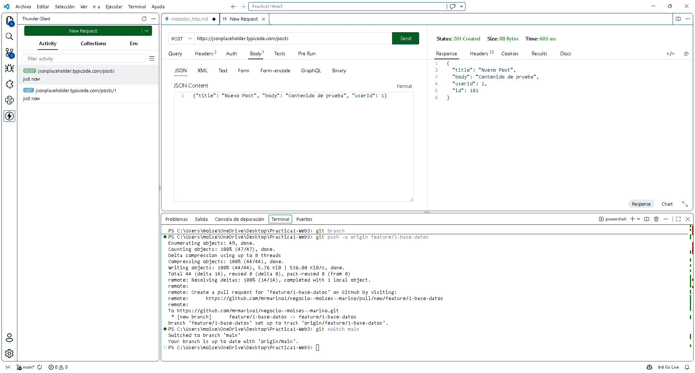
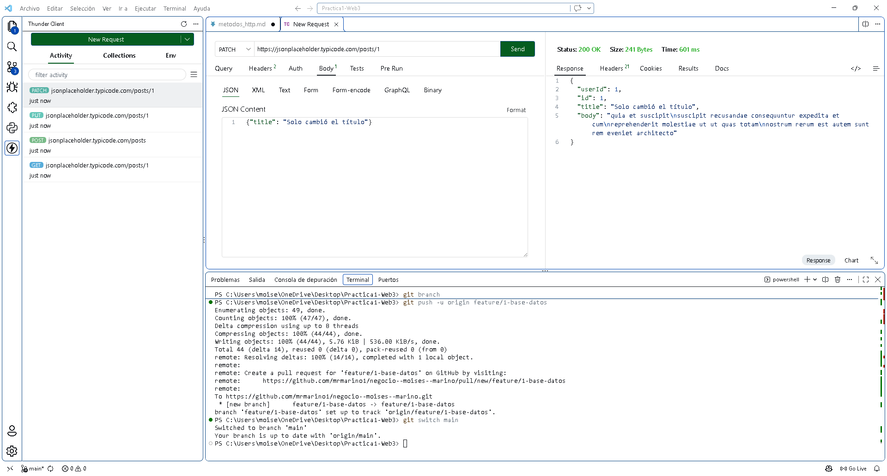

# Métodos HTTP

## 1. GET

**Para qué sirve:** Solicita la representación de un recurso específico sin alterar el servidor.
**Cómo se usa:** Se envía una petición indicando la URL del recurso a consultar. No lleva cuerpo (body).
**Ejemplo con Thunder Client:**
  - **URL:** `https://jsonplaceholder.typicode.com/posts/1`

  - **Body:** Ninguno

  - **Código de estado:** `200 OK`

  - **Captura:**

    

## 2. POST

**Para qué sirve:** Envía datos para crear un nuevo recurso en el servidor.
**Cómo se usa:** Se envía la información en formato JSON dentro del cuerpo de la petición.
**Ejemplo con Thunder Client:**
  - **URL:** `https://jsonplaceholder.typicode.com/posts`

  - **Body:** `{"title": "Nuevo Post", "body": "Contenido de prueba", "userId": 1}`

  - **Código de estado:** `201 Created`

  - **Captura:**

    

## 3. PUT

**Para qué sirve:** Reemplaza por completo un recurso existente o lo crea si no existe.
**Cómo se usa:** Se envía el objeto completo actualizado en el cuerpo.
**Ejemplo con Thunder Client:**
  - **URL:** `https://jsonplaceholder.typicode.com/posts/1`

  - **Body:** `{"id": 1, "title": "Actualizado", "body": "Nuevo texto", "userId": 1}`

  - **Código de estado:** `200 OK`

  - **Captura:**

    

## 4. PATCH

**Para qué sirve:** Realiza una modificación parcial a un recurso (solo los campos que se envían).
**Cómo se usa:** Se envían únicamente los campos que se desean cambiar en el cuerpo.
**Ejemplo con Thunder Client:**
  - **URL:** `https://jsonplaceholder.typicode.com/posts/1`

  - **Body:** `{"title": "Solo cambió el título"}`

  - **Código de estado:** `200 OK`

  - **Captura:**

    

## 5. DELETE

**Para qué sirve:** Elimina un recurso específico del servidor.
**Cómo se usa:** Se indica la URL del recurso que se desea borrar. No requiere cuerpo.
**Ejemplo con Thunder Client:**
  - **URL:** `https://jsonplaceholder.typicode.com/posts/1`

  - **Body:** Ninguno

  - **Código de estado:** `200 OK` (o `204 No Content`)

  - **Captura:**

    

## Diferencia entre PUT y PATCH

**PUT** reemplaza todo el recurso de forma integral; si omites algún campo al actualizar, este se borra o se sobrescribe con valores por defecto.
**PATCH** actualiza únicamente los campos específicos que envíes, dejando el resto del recurso intacto.
*(Nota: JSONPlaceholder simula los cambios en memoria, por lo que un GET posterior no mostrará los cambios guardados de verdad).* 